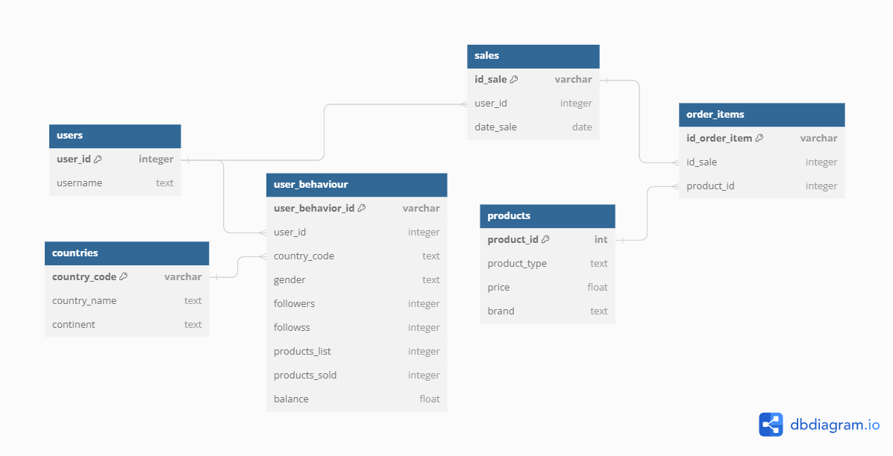

# Tableaux de bord e-commerce avec Storm BI

Projet de business intelligence réalisé avec le logiciel [Storm](https://www.stormcorp.ch/). Il porte sur les données d'une boutique de mode en ligne fictive : clients, produits, ventes et activité des utilisateurs sur le site. Le projet inclut d'abord une modélisation des données dans une base MySQL, puis une analyse de ces données dans Storm à travers trois tableaux de bord interactifs.



## Contenu

- **Sales** : nombre de ventes par année et par saison, ventes par client, nombre de clients ayant acheté.
- **Order items** : ventes par marque et par type de vêtement, marque la plus achetée, chiffre d'affaires total, frais moyens, dernière commande.
- **User behaviour** : carte du nombre d'utilisateurs par pays, répartition hommes/femmes, abonnés moyens par pays, communauté par continent, solde et produits vendus par pays et par genre.

Les tableaux de bord combinent des KPI, des tableaux croisés dynamiques, des graphiques et une carte. Ils reposent sur des mesures calculées, comme les frais de livraison ou la taille de la communauté (abonnés + abonnements).

## Structure

```
├── project.xml        # Fichier du projet Storm (connexion à la base de données)
├── core/              # Définitions des tableaux de bord, KPI, pivots, graphiques, requêtes…
├── e-commerce_*.sql   # Tables de la base de données (une par fichier)
└── DB_Finale_Schema.png
```
